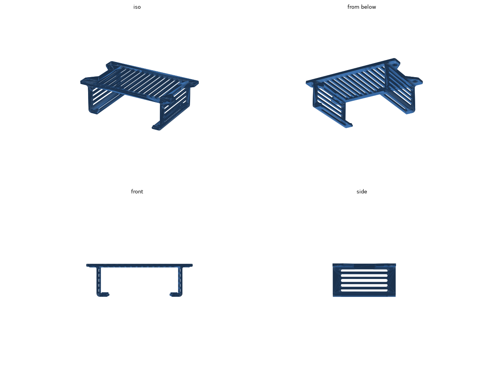
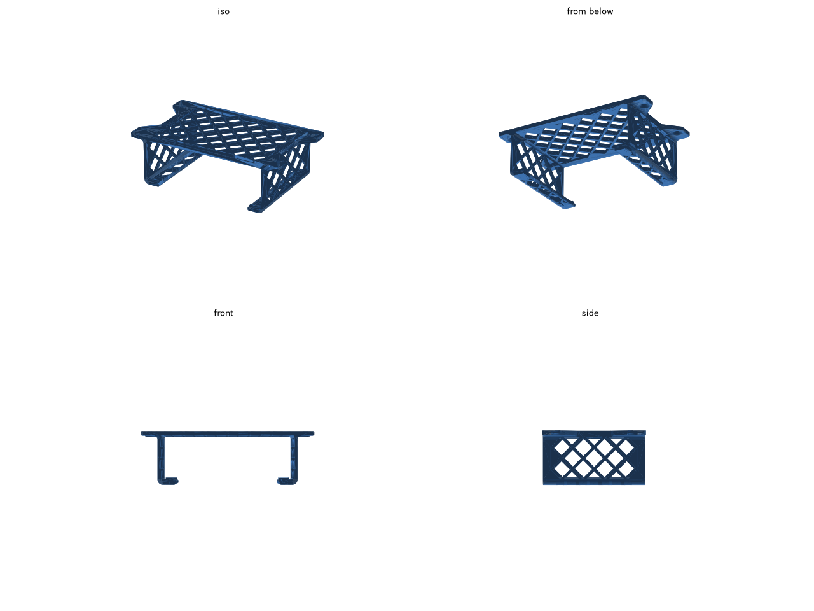
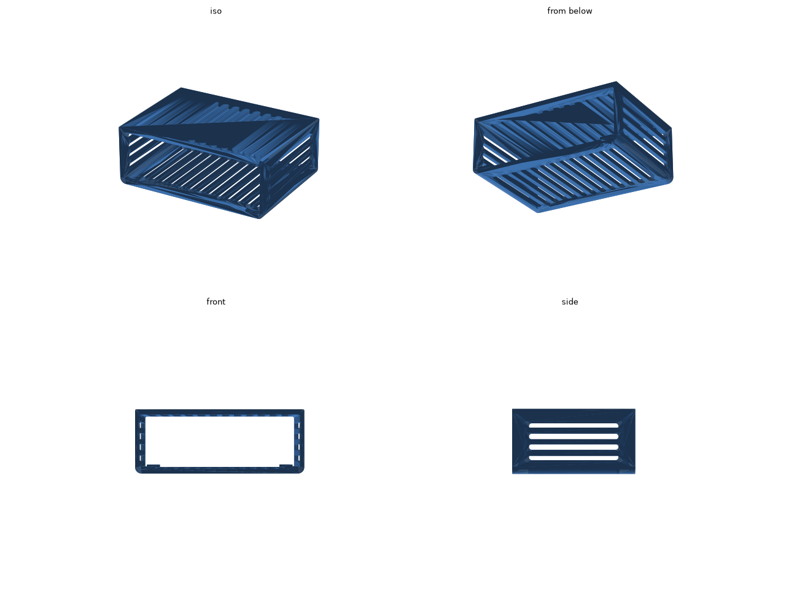
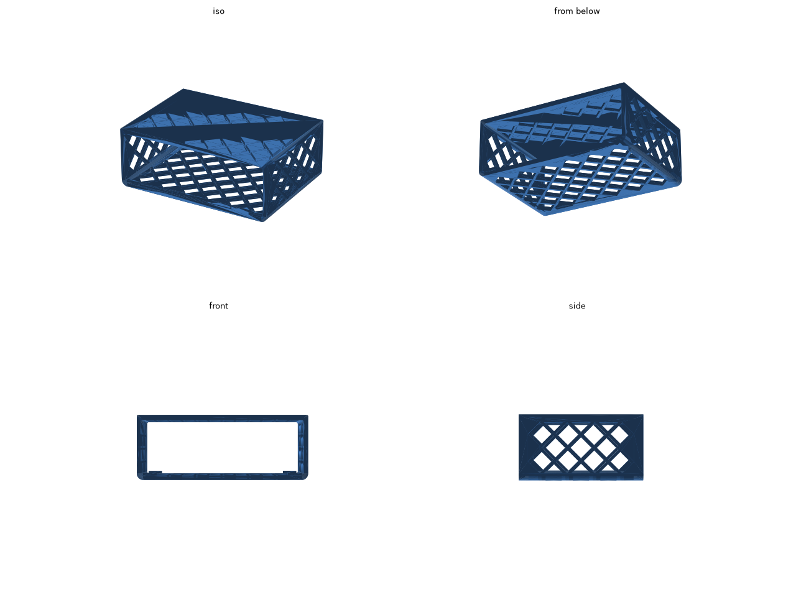

# Anker PowerExpand Elite 13-in-1 デスク下ホルダー

[Anker PowerExpand Elite 13-in-1 Thunderbolt 3 Dock](https://www.ankerjapan.com/products/a8396) をデスクの天板の裏に取り付けるホルダーです。前後が開いているので、ドックは前か後ろから差し込みます。前後のポートはふさぎません。

取り付け方は木ネジで留めるものと、両面テープで貼るものの 2 種類があります。それぞれに通気口のデザインが 2 種類あります。

## 木ネジで留める

左右のフランジを、4mm の皿木ネジ 4 本で天板の裏に下から留めます。下はレールでドックの左右のふちを受けるだけで、中央は開いています。

| stripe | lattice |
| --- | --- |
|  |  |
| 前後に長い角丸スリット。すっきりした見た目 | ひし形の格子。トラスのような見た目で少し軽い |
| [stl/holder-stripe.stl](stl/holder-stripe.stl) (約 52 cm³) | [stl/holder-lattice.stl](stl/holder-lattice.stl) (約 48 cm³) |

外形は 164.2 × 95.5 × 50.6 mm です。

## 両面テープで貼る

フランジをなくし、天板側の板を穴のない平らな面にしたので、全面に両面テープを貼れます。板の内側だけを肉抜きしています。下は床でふさいでドックを全面で受け、木ネジ用より側壁を厚く (2.6 → 3.2 mm)、スリットの間の骨を太く (3 → 4 mm) して強くしました。

| stripe | lattice |
| --- | --- |
|  |  |
| [stl/holder-stripe-tape.stl](stl/holder-stripe-tape.stl) (約 82 cm³) | [stl/holder-lattice-tape.stl](stl/holder-lattice-tape.stl) (約 69 cm³) |

外形は 133.4 × 95.5 × 50.6 mm です。

ドックとケーブルの重さがかかり続けるので、耐荷重に余裕のある両面テープを使ってください。貼る前に天板の裏の汚れを拭き取ってください。

## 印刷

- どれも A1 mini に収まります。
- STL はドックの前面にあたる面を下にした向きで書き出してあります。そのまま置けば、サポートなしで印刷できます。
- 素材は、ドックの熱と重さ (約 490 g) に強い PETG がおすすめです。壁は 3 周以上、インフィルは 15〜25% にしてください。

## 寸法の調整

ドックの寸法 (約 125.8 × 88.5 × 41.9 mm) は、[個人ブログ](https://scrapbox.io/shiology/06225_Anker_PowerExpand_Elite_13-in-1_Thunderbolt_3_Dock%E5%B0%8E%E5%85%A5)に載っていた数値です。印刷する前に実物を測ってください。違っていたら、`holder.py` の冒頭にある `DOCK_W` / `DOCK_D` / `DOCK_H` を直し、リポジトリのルートで `make` を実行します。

ほかに調整できる値も `holder.py` の冒頭にまとめてあります。

| 値 | 意味 |
| --- | --- |
| `CLEAR_W` / `CLEAR_H` / `CLEAR_D` | ドックとのすき間 |
| `WALL` / `RAIL_T` / `PLATE_T` | 側壁、下のレールか床、天板側の板の厚さ |
| `SCREW_D` / `CSK_D` | ネジ穴の径と皿ザグリの径 |
| `TAPE_SKIN` | 両面テープで貼るとき、天板側の板の貼る面に残す厚さ |
| `SLOT_W` / `SLOT_RIB` | stripe のスリットの幅と、スリットの間の骨の太さ |
| `VENT_H` / `VENT_RIB` | lattice のひし形の大きさと、ひし形の間の骨の太さ |

1 つだけ作るときは、次のように実行します。`--mount` で取り付け方を、`--floor` で下を床でふさぐかを選びます。

```sh
../.venv/bin/python holder.py --style stripe -o stl/holder-stripe.stl
../.venv/bin/python holder.py --style stripe --mount tape --floor --wall 3.2 --rib 4 -o stl/holder-stripe-tape.stl
```
