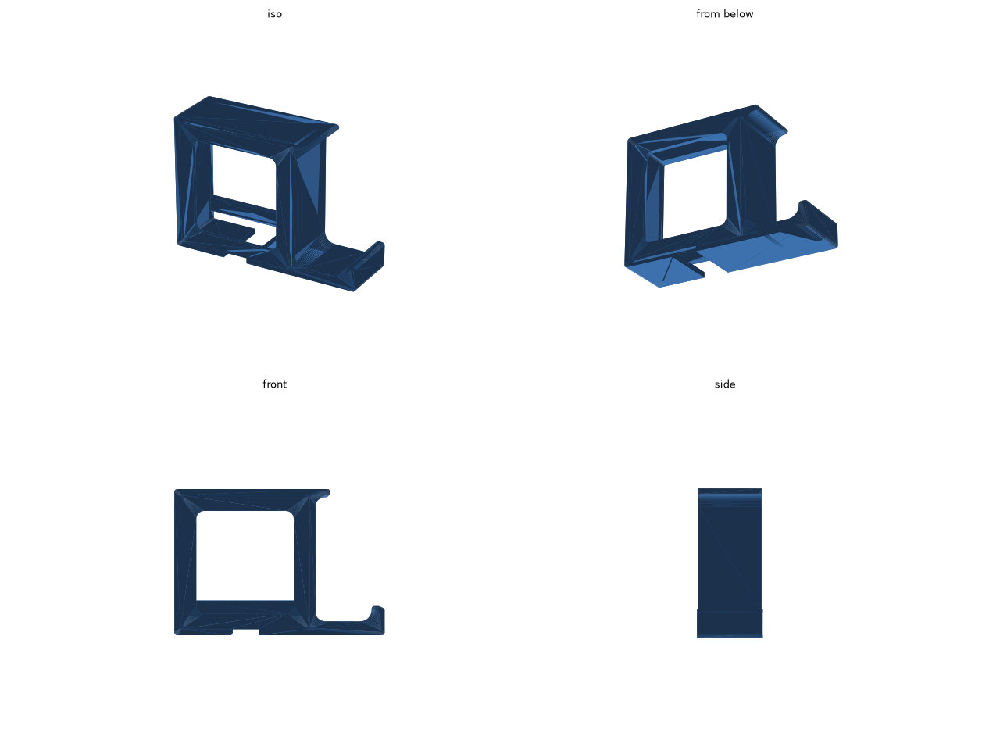

# 机の下のイヤホン・ヘッドホンハンガー

イヤホンのケースとヘッドホンを、充電ケーブルを差したまま机の天板の裏に掛けておくハンガーです。上の板を両面テープで天板の裏に貼ります。

- 左のポケット: イヤホンのケースを立てて入れます。底の真ん中は前後に抜けたすき間になっていて、ケースの底に差したケーブルを前から通せます。手前の下のほうに渡した棒で、ケースが前へ倒れ出ません。
- 右のフック: ヘッドホンのヘッドバンドを掛けます。腕の先が上に折れているので、ヘッドバンドが抜けません。

[stl/hanger.stl](stl/hanger.stl) (約 41 cm³)

## 寸法

- 外形: 106.5 × 32 × 74 mm (幅 × 奥行き × 高さ)
- 天板に貼る面: 106.5 × 32 mm
- ポケットの内側: 65.5 × 26.5 mm

ケースの寸法は、AirPods Pro (第 2 世代) のケース (60.6 × 21.7 × 45.2 mm) にカバーを付けた大きさを見込んで、64 × 25 × 50 mm にしています。使っているケースを測って、`hanger.py` の冒頭の `CASE_W` / `CASE_T` / `CASE_H` を直してください。直したら、リポジトリのルートで `make desk-audio-hanger` を実行します。

## 入れ方

1. ケーブルを、ポケットの底のすき間に前から通します。
2. ケースの底にケーブルを差します。
3. ケースを、手前の棒の上を越えるように斜めに入れ、底に立てます。

取り出すときは、ケースを棒の上まで持ち上げて手前に引きます。

## 印刷

- 奥の面を下にした向きで書き出してあります。そのまま置けば、サポートなしで印刷できます。
- 手前の棒は、左右の壁の間に渡したブリッジとして印刷されます。
- 素材は PLA でも PETG でもかまいません。

## 寸法の調整

| 値 | 意味 |
| --- | --- |
| `CASE_W` / `CASE_T` / `CASE_H` | イヤホンのケースの幅、厚さ、高さ |
| `CLEAR` | ケースとのすき間 |
| `CABLE_W` | 底の、ケーブルのプラグを通すすき間の幅 |
| `BAR_Z0` / `BAR_Z1` | 手前の棒の下の端と上の端の高さ (底の上面から) |
| `ARM` / `LIP_H` | フックの腕の長さと、先の折れ上がりの高さ |
