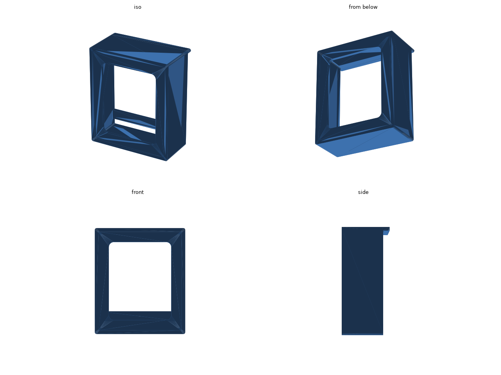
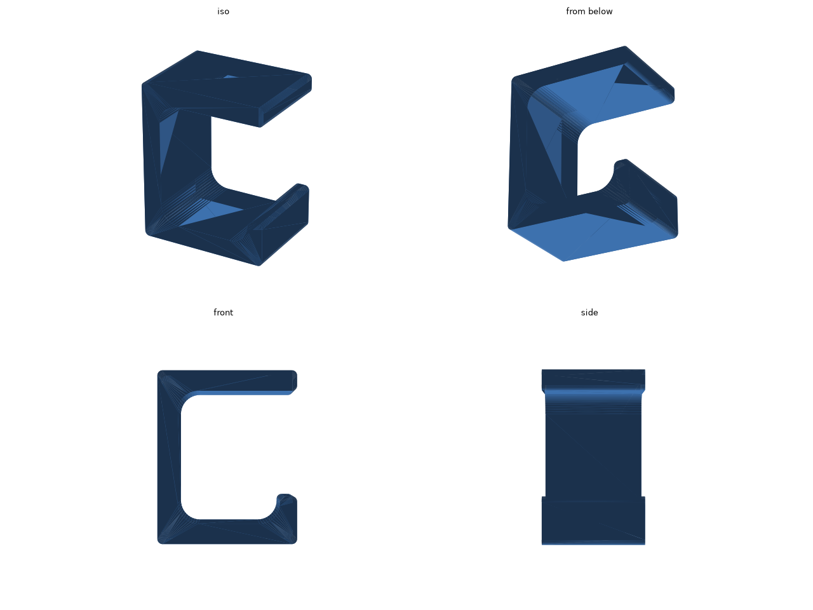

# 机の下のイヤホン・ヘッドホンハンガー

イヤホンのケースとヘッドホンを、充電ケーブルを差したまま机の下に掛けておく部品です。どれも両面テープで貼ります。置き場所に合わせて、次の 2 通りの組み合わせから選びます。

- 天板の裏にまとめて貼る: [hanger](#hanger-ポケットとフック) を 1 つ
- イヤホンのケースを充電器の真下に置く: [cradle](#cradle-充電器の下の受け皿) と [hook](#hook-ヘッドホンのフック) を 1 つずつ

ケースの寸法は、AirPods Pro (第 2 世代) のケース (60.6 × 21.7 × 45.2 mm) にカバーを付けた大きさを見込んで、64 × 25 × 50 mm にしています。使っているケースを測って、`hanger.py` の冒頭の `CASE_W` / `CASE_T` / `CASE_H` を直してください。直したら、リポジトリのルートで `make desk-audio-hanger` を実行します。

## hanger: ポケットとフック

天板の裏に貼ります。左のポケットにイヤホンのケースを、充電口を下にして立てて入れます。右のフックにはヘッドホンのヘッドバンドを掛けます。

- [stl/hanger.stl](stl/hanger.stl) (約 41 cm³)
- 外形: 106.5 × 32 × 74 mm (幅 × 奥行き × 高さ)。天板に貼る面は 106.5 × 32 mm です。

ポケットの底の真ん中は前後に抜けたすき間になっていて、ケーブルを前から通せます。入れ方は次のとおりです。

1. ケーブルを、ポケットの底のすき間に前から通します。
2. ケースの底にケーブルを差します。
3. ケースを、手前の棒の上を越えるように斜めに入れ、底に立てます。

## cradle: 充電器の下の受け皿

充電器 ([エレコム EC-AC12945](https://www.amazon.co.jp/dp/B0H3TNNX57)) の下の面に貼り、充電器の真下にイヤホンのケースを置く受け皿です。ケースは充電口を上にして (ふたを下にして) 立て、充電器から伸ばしたケーブルを上から差します。

- [stl/cradle.stl](stl/cradle.stl) (約 36 cm³)
- 外形: 71.5 × 37 × 84 mm (幅 × 奥行き × 高さ)。充電器に貼る面は 71.5 × 37 mm です。
- 貼る板の奥行きは、充電器の奥行き (37 mm) にそろえてあります。充電器の幅は 62 mm なので、板は左右に 5 mm ほどはみ出します。
- ケースの上から充電器の下の面までは 28 mm 空けてあり、そこにプラグを差します。

ケースを手前の棒の上を越えるように斜めに入れて底に立ててから、ケーブルを差します。

受け皿とケースの重さ (合わせて 100 g ほど) は、充電器 (約 145 g) を留めているところにもかかります。充電器がしっかり留まっているかを確かめてから貼ってください。

## hook: ヘッドホンのフック

天板の裏に貼る、ヘッドホンを掛けるフックだけの部品です。cradle と組み合わせて使います。

- [stl/hook.stl](stl/hook.stl) (約 24 cm³)
- 外形: 41 × 30 × 51 mm (幅 × 奥行き × 高さ)。天板に貼る面は 41 × 30 mm です。

## 印刷

- どれも奥の面を下にした向きで書き出してあります。そのまま置けば、サポートなしで印刷できます。
- 手前の棒は、左右の壁の間に渡したブリッジとして印刷されます。
- 素材は PLA でも PETG でもかまいません。

## 寸法の調整

| 値 | 意味 |
| --- | --- |
| `CASE_W` / `CASE_T` / `CASE_H` | イヤホンのケースの幅、厚さ、高さ |
| `CLEAR` | ケースとのすき間 |
| `CABLE_W` | hanger の底の、ケーブルのプラグを通すすき間の幅 |
| `PLUG_H` | cradle の、ケースの上から充電器の下の面までのすき間 |
| `CHARGER_D` | cradle の貼る板の奥行き (充電器の奥行き) |
| `BAR_Z0` / `BAR_Z1` | 手前の棒の下の端と上の端の高さ (底の上面から) |
| `ARM` / `LIP_H` | フックの腕の長さと、先の折れ上がりの高さ |
| `HOOK_H` | hook の、貼る面から腕の下の面までの高さ |
