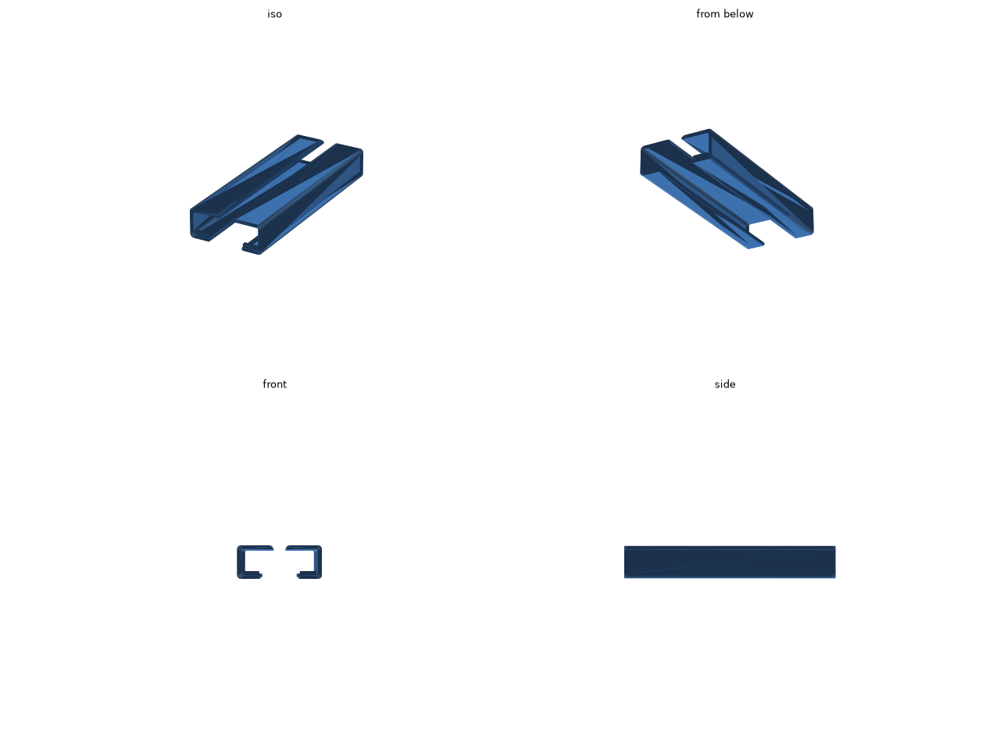

# iPad Pro 11 インチ (M4) 机の下レール

iPad Pro 11 インチ (M4) を、机の天板の裏に寝かせてしまうためのレールです。

iPad の幅は 249.7 mm あり、A1 mini の造形範囲 (180 mm) に収まらないので、左右 2 本のレールに分けています。レールは前後方向に伸び、iPad の左右のふちを下の棚 (幅 15 mm) で受けます。iPad は前から差し込むと奥の抜け止めで止まり、長さ 170 mm のレールから手前が約 7 mm はみ出すので、そこをつかんで引き出せます。

STL: [stl/rails.stl](stl/rails.stl) (2 本で約 66 cm³)

## 寸法

- 左右のレールの壁の内側どうしの間隔: 251.7 mm (iPad の幅 + 2 mm)
- 棚の上面から上の板の下面までの高さ: 20 mm (ケースを付けても入ります)
- 1 本の外形: 28 × 170 × 26 mm

## 印刷

- STL は 2 本を並べ、手前の端の面を下にした向きで書き出してあります。そのまま置けば、サポートなしで印刷できます。
- 素材は PLA でも PETG でもかまいません。

## 天板への貼り方

上の板 (幅 25 mm) に両面テープを貼って、天板の裏に貼ります。左右の間隔をそろえるには、先に 2 本のレールに iPad を差し込み、iPad ごと持ち上げて貼る方法が簡単です。

## 寸法の調整

`rails.py` の冒頭の値を直して、リポジトリのルートで `make ipad-pro-11-rails` を実行します。

| 値 | 意味 |
| --- | --- |
| `IPAD_W` / `IPAD_D` / `IPAD_T` | iPad の幅、奥行き、厚さ |
| `CLEAR_W` | 左右のすき間の合計 |
| `INNER_H` | 棚の上面から上の板の下面までの高さ |
| `LENGTH` | レールの長さ (A1 mini では 180 mm まで) |
| `SHELF_W` / `TAB_W` | 下の棚と上の板の張り出し |
| `STOP_H` | 奥の抜け止めの高さ |
