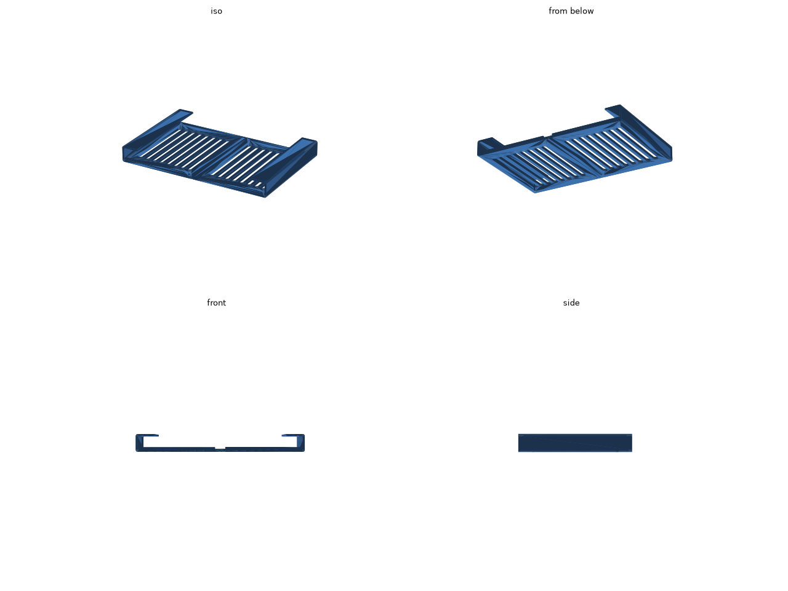
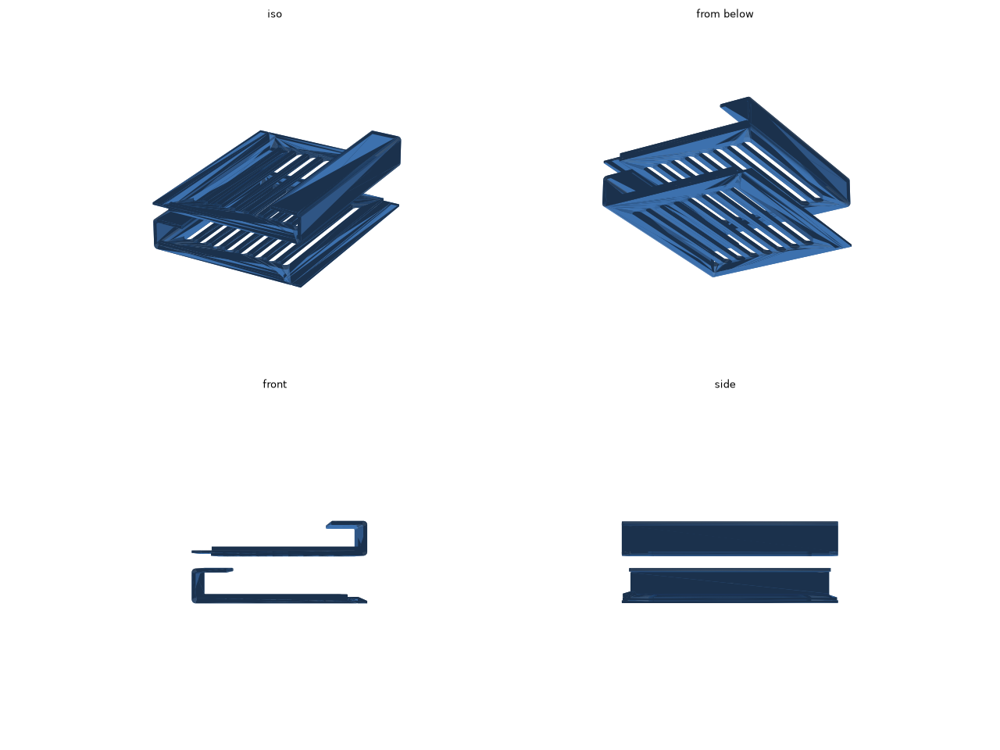

# iPad Pro 11 インチ (M4) 机の下トレー

iPad Pro 11 インチ (M4) を、机の天板の裏に寝かせてしまうトレーです。断面がコの字で、底板に iPad を載せ、上の板を両面テープで天板の裏に貼ります。

iPad の幅は 249.7 mm あり、A1 mini の造形範囲 (180 mm) に収まらないので、トレーを左右の半分に分けています。左右の底板は真ん中で 15 mm 幅だけ段違いに重なり、右の底板が左の底板の上に載ります。iPad の通り道には何も出っ張りません。

iPad は前から差し込むと奥の抜け止めで止まり、手前が約 14 mm はみ出すので、そこをつかんで引き出せます。

STL: [stl/tray.stl](stl/tray.stl) (左右の半分で約 160 cm³)

## 寸法

- 組んだときの外形: 257.7 × 170 × 27 mm
- 左右の壁の内側どうしの間隔: 251.7 mm (iPad の幅 + 2 mm)
- 底板の上面から上の板の下面までの高さ: 20 mm (ケースを付けても入ります)

## 印刷

- STL は左右の半分を前後に並べ、手前の端の面を下にした向きで書き出してあります。プレートの上では 136.4 × 64.0 mm、高さ 170 mm です。
- そのまま置けば、サポートなしで印刷できます。
- 素材は PLA でも PETG でもかまいません。

## 天板への貼り方

左右の半分の底板を真ん中で重ね、上の板 (幅 25 mm) に両面テープを貼って天板の裏に貼ります。

## 寸法の調整

`tray.py` の冒頭の値を直して、リポジトリのルートで `make ipad-pro-11-tray` を実行します。

| 値 | 意味 |
| --- | --- |
| `IPAD_W` / `IPAD_D` / `IPAD_T` | iPad の幅、奥行き、厚さ |
| `CLEAR_W` | 左右のすき間の合計 |
| `INNER_H` | 底板の上面から上の板の下面までの高さ |
| `LENGTH` | トレーの奥行き (A1 mini では 180 mm まで) |
| `FLOOR_T` / `LAP` | 底板の厚さと、真ん中で重なる幅 |
| `TAB_W` | 上の板の張り出し |
| `STOP_H` | 奥の抜け止めの高さ |
| `SLOT_W` / `SLOT_RIB` | 底板の肉抜きスリットの幅と、スリットの間の骨の太さ |
