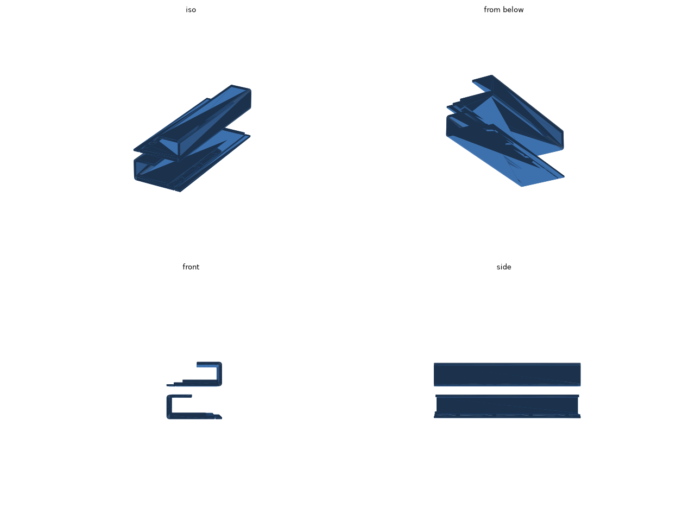
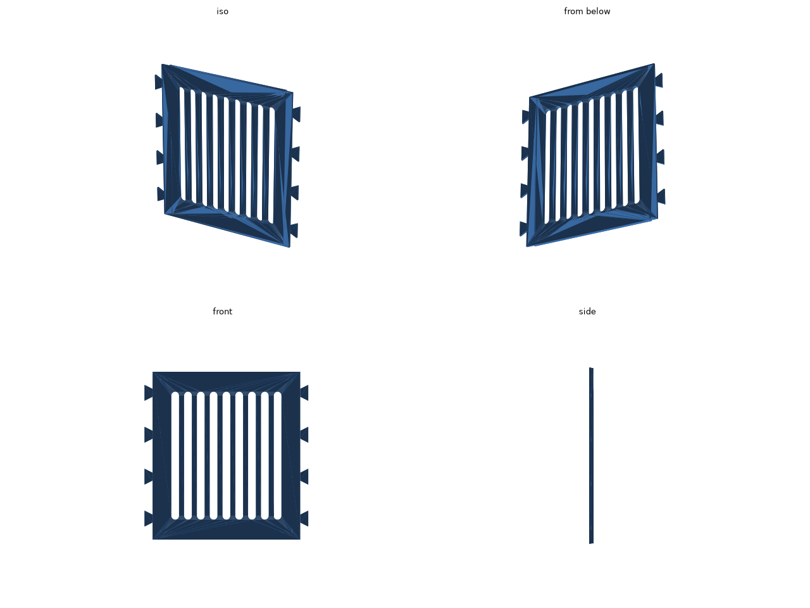

# iPad Pro 11 インチ (M4) 机の下トレー

iPad Pro 11 インチ (M4) を、机の天板の裏に寝かせてしまうトレーです。断面がコの字で、底板に iPad を載せ、上の板を両面テープで天板の裏に貼ります。

iPad の幅は 249.7 mm あり、A1 mini の造形範囲 (180 mm) に収まらないので、左右のレールと真ん中の板の 3 つに分けています。

真ん中の板は、左右のふちに蟻の形の凸が 4 つずつあり、上からレールの切り欠きにはめ込みます。レールの底板は 2 段になっていて、下の段が内側へ 8 mm 長く伸び、真ん中の板のふちを下から受けます。はめると上面はレールと平らにそろい、左右にも前後にも外れません。

iPad は前から差し込むと奥の抜け止めで止まり、手前が約 14 mm はみ出すので、そこをつかんで引き出せます。

STL は 2 つあります。

- [stl/rails.stl](stl/rails.stl): 左右のレール 2 本 (約 125 cm³)
- [stl/plate.stl](stl/plate.stl): 真ん中の板 (約 61 cm³)

## 寸法

- 組んだときの外形: 257.7 × 170 × 27 mm
- 左右の壁の内側どうしの間隔: 251.7 mm (iPad の幅 + 2 mm)
- 底板の上面から上の板の下面までの高さ: 20 mm (ケースを付けても入ります)

## 印刷

| レール | 真ん中の板 |
| --- | --- |
|  |  |

- 2 回に分けて印刷します。どちらもそのまま置けば、サポートなしで印刷できます。
  - レール: 2 本を並べ、手前の端の面を下にした向きです。プレートの上では 61.9 × 64.0 mm、高さ 170 mm です。
  - 真ん中の板: 上面を下にした向きです。166 × 170 mm、厚さ 4 mm です。
- 素材は PLA でも PETG でもかまいません。
- 蟻の凸がきつくて入らないときは、`DT_GAP` を 0.1 mm ずつ増やしてください。

## 組み方と貼り方

左右のレールを並べ、真ん中の板を上からはめ込みます。組んだトレーの上の板 (幅 25 mm) に両面テープを貼って、天板の裏に貼ります。

## 寸法の調整

`tray.py` の冒頭の値を直して、リポジトリのルートで `make ipad-pro-11-tray` を実行します。

| 値 | 意味 |
| --- | --- |
| `IPAD_W` / `IPAD_D` / `IPAD_T` | iPad の幅、奥行き、厚さ |
| `CLEAR_W` | 左右のすき間の合計 |
| `INNER_H` | 底板の上面から上の板の下面までの高さ |
| `LENGTH` | トレーの奥行き (A1 mini では 180 mm まで) |
| `FLOOR_T` | 底板の厚さ |
| `PLATE_W` | 真ん中の板の幅 (凸を除く) |
| `LEDGE` | レールの下の段が真ん中の板を受ける幅 |
| `DT_N` / `DT_NECK` / `DT_HEAD` / `DT_DEPTH` | 蟻の凸の数、付け根の幅、先の幅、長さ |
| `DT_GAP` | はめ合いのすき間 |
| `TAB_W` | 上の板の張り出し |
| `STOP_H` | 奥の抜け止めの高さ |
| `SLOT_W` / `SLOT_RIB` | 真ん中の板の肉抜きスリットの幅と、スリットの間の骨の太さ |
