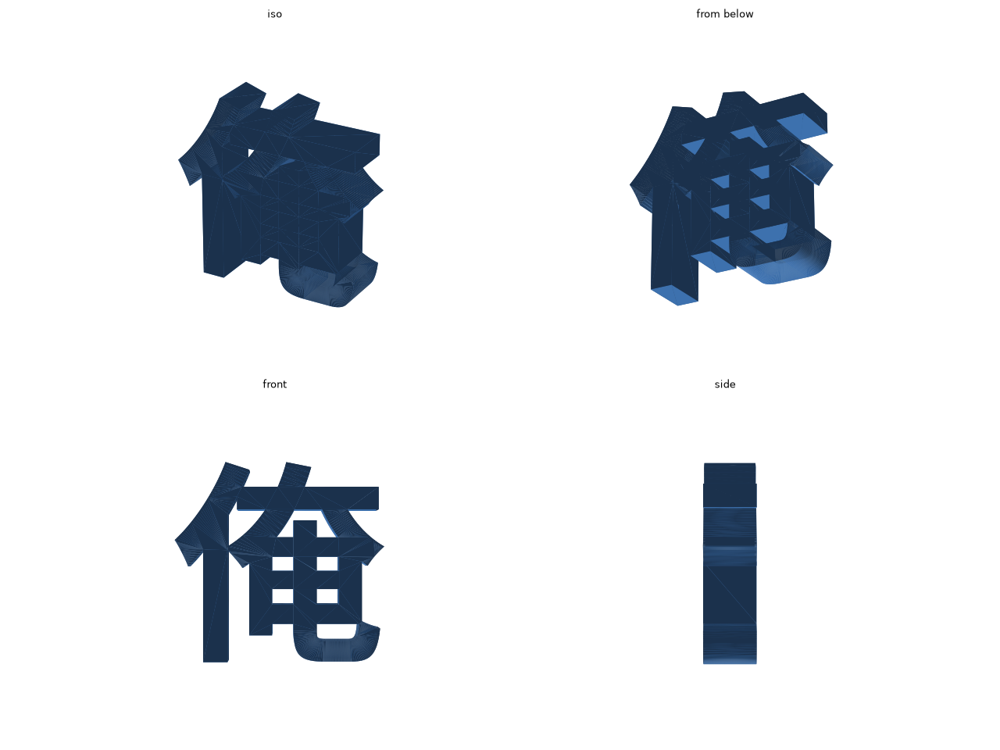

# 「俺」の字のオブジェ

「俺」の字を立てて飾るオブジェです。台座はありません。字の「亻」と「奄」がくっついているので 1 個の部品になり、「亻」の縦棒と「乚」のはねの 2 か所で床に着いて自立します。

STL: [stl/ore.stl](stl/ore.stl) (約 52 cm³)

## 印刷

- 外形は 73.3 × 70.0 × 18.0 mm です。
- STL は字の面を下にした向きで書き出してあります。そのまま置けば、サポートなしで印刷できます。
- 素材は PLA でかまいません。

## 字形

字形には [Noto Sans JP](https://fonts.google.com/noto/specimen/Noto+Sans+JP) (SIL Open Font License) を使っています。フォントは `ore.py` を初めて実行したときにリポジトリの `.cache/` へダウンロードされます。

## 字と寸法の変え方

`ore.py` の冒頭の値を直して、リポジトリのルートで `make ore` を実行します。

| 値 | 意味 |
| --- | --- |
| `CHAR` | 字。別の字にも変えられます |
| `WEIGHT` | 字の太さ (100〜900) |
| `HEIGHT` | 台座を除いた字の高さ |
| `THICK` | 字の厚み |
| `BASE_H` | 台座の帯の高さ。0 より大きくすると、字の下に台座の帯を付けます |
